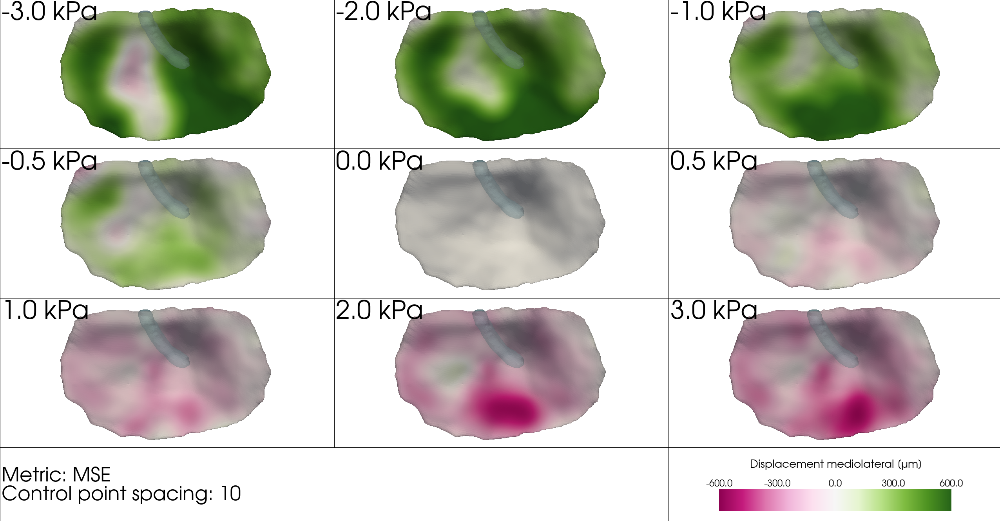

# Tympanic Membrane Deformation Tracking via X-Ray GI-CT

This repository contains the prototyping codebase for a semester project conducted at the **Institute for Biomedical Engineering (ETH Zürich / University of Zurich)** and the **Paul Scherrer Institute (PSI)**. 

The project extends an existing rigid-body ossicular motion pipeline to track and visualize non-rigid deformations of the human tympanic membrane (TM) under quasi-static pressure loads (-3 kPa to +3 kPa) using table-top Grating-Interferometry Computed Tomography (GI-CT).

> **Note:** Due to data privacy and institutional restrictions, the underlying GI-CT volumes, segmentation masks, and anatomical landmark files cannot be made publicly available. Consequently, the scripts in this repository are not directly executable and serve as a reference for the registration methodology and workflow.

---

## Pipeline Overview

The workflow consists of three sequential stages executed across a SLURM compute cluster and a local workstation:

1. **Denoising (`denoise.py`)**
   * Loads 3D GI-CT volumes across four contrast channels (`attenuation`, `fused`, `refraction`, and `diffusion`) from `.h5` datasets.
   * Estimates noise levels ($\sigma$) and applies 3D Non-Local Means filtering (`skimage.restoration.denoise_nl_means`) per pressure step.
   * Outputs pickled `xarray.Dataset` objects (`<channel>_denoised.pkl`).

2. **Rigid & Non-Rigid Registration (`calcTfmsDenoised.py`)**
   * **Rigid Alignment:** Computes 3D Euler rigid transformations (`SimpleITK.Euler3DTransform`) on the high-SNR `fused` channel to account for global specimen motion relative to the 0 kPa baseline.
   * **Non-Rigid Registration:** Crops the volumes to a region of interest (ROI) around the tympanic membrane and performs masked B-Spline registration (`SimpleITK.BSplineTransform`) across a hyperparameter grid of control point spacings (`3–15 px`) and L-BFGS-B optimizer iterations (`10–160`). Sequential pressure steps are initialized from previous pressure transforms for stability.
   * **Displacement Extraction:** Transforms the 3D TM surface mesh points, reference curve, and umbo landmark into the anatomical coordinate frame (mediolateral, anteroposterior, inferosuperior) and converts displacements to micrometers ($\mu\text{m}$).
   * Saves the resulting displacement fields (excluding raw image arrays) into a single pickled `xarray.Dataset`.

3. **Visualization (`visualization.py`)**
   * Loads the lightweight displacement dataset locally.
   * Generates interactive 3D surface displacement maps of the tympanic membrane and umbo using `PyVista` across pressure levels and registration hyperparameters for comparison against literature benchmarks.
   
---

## Project Credits
* **Student:** Daniel Böhm (D-ITET, ETH Zürich)
* **Supervisor:** Prof. Dr. Marco Stampanoni (ETH Zürich / PSI)
* **Advisers:** Dominik Etter, Dr. Gianluca Iori (Institute for Biomedical Engineering, ETH Zürich)
